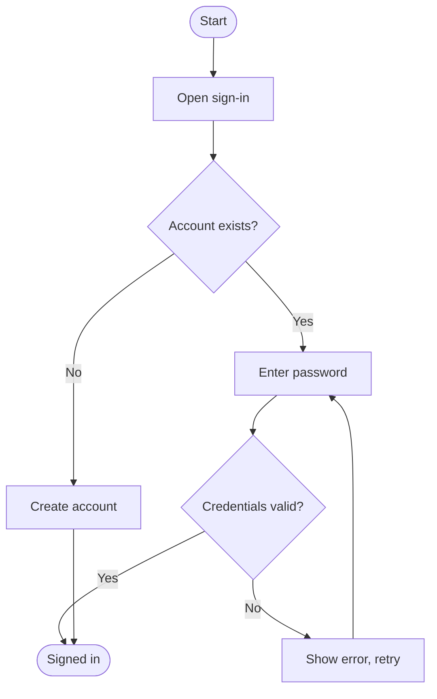

# UX Visualization Assistant

Recommends the right UX artifact for what you want to show, from user flows to empathy maps, and builds it as a Mermaid diagram or markdown table, filed in the right folder.

## When to Use This Skill

- You know what to show but not which diagram shows it
- Unsure between lookalikes, such as user flow or task flow
- Writing a module's user flows, the sitemap or other research-tree files
- Reviewing or improving a diagram someone already made
- Turning one artifact into another, such as a journey into a user flow

## What This Skill Does

1. **Reads the Guide**: The project's UX Visualization Guide, else the built-in one
2. **Recommends One Artifact**: Names the best fit, with a one-line reason
3. **Settles Lookalikes**: Tests each confusable pair, asking at most one question
4. **Builds to the Standard**: Mermaid or a table, the guide's notation, no invented facts
5. **Reviews and Converts**: Checks existing artifacts, or changes their form faithfully
6. **Files It Correctly**: Saves to the right folder under a kebab-case name

## How to Use

### Basic Usage

Install it into your project once with `aistack add ux-visualization-assistant`, then ask:

```
Which visualization should I use to compare us against three competitors?
```

### Generate an Artifact

```
Generate a user flow for signing in
```

```
Create an empathy map from these interview notes
```

### Review or Improve

```
Review this diagram
```

```
Improve this journey map
```

### Convert

```
Turn this user journey into a user flow
```

```
Convert this table to a flow
```

### Automatically

It also steps in on its own when you work on files in the research tree (a module's `userflows.md`, `information-architecture.md`, `sitemap.md`) or mention flows, journeys, personas, sitemaps or "which diagram should I use".

## Example

**User**: "Show how a user signs in, including when they don't have an account yet"

**Result**: "A user flow, because there are decisions (does the account exist, are the credentials valid) and an error path."



## Tips

- Zero decision points means a task flow; any branch or error, a user flow
- Our product and a named persona means a journey; generic behaviour, an experience map
- Concrete screens means a sitemap; grouping and labels, information architecture
- A reusable archetype means a persona; one fresh research segment, an empathy map
- Ask for one artifact per goal; several are made separately
- Tune the guide in `project-management/research/internal/product-knowledge/ux-research/ux-visualization-guide.md`; it beats the built-in one

## Related Use Cases

- **research-workspace**: sets up the research tree and seeds the project's copy of the UX Visualization Guide
- **create-competitor-profile**: its profiles carry a Mermaid feature map and persona user flows this skill can check

## Where Artifacts Go

| Artifact | Location |
|---|---|
| Module user flows | `project-management/research/internal/product-knowledge/modules/<module>/userflows.md` |
| Information architecture | `project-management/research/internal/product-knowledge/information-architecture.md` |
| Sitemap | `project-management/research/internal/product-knowledge/sitemap.md` |
| Personas | `project-management/research/internal/product-knowledge/user-personas/` |
| Empathy maps, journeys, experience maps | `project-management/research/internal/product-knowledge/ux-research/` |
| Competitive analysis | `project-management/research/external/competitor-analysis/` |

An older workspace keeps `research/` at the project root; there, the same paths apply without the `project-management/` prefix.
